# Sistema IoT de seguridad

Parcial #2 de Desarrollo de Software VIII (IoT y sistemas embebidos), Universidad Tecnológica de Panamá. Grupo 8.

Es un sistema de seguridad simulado en Wokwi con un ESP32. Detecta movimiento y objetos cercanos, activa una alarma local, publica lo que pasa por MQTT, guarda el histórico en una base de datos SQLite y muestra el estado en un dashboard de ThingSpeak, desde donde también se pueden mandar comandos al dispositivo.

Escenario elegido: Sistema de Seguridad (detección y alertas).

## Cómo funciona

El ESP32 lee el sensor PIR y el HC-SR04. Si hay movimiento, o algo a menos de 50 cm, y el sistema está armado, enciende el LED y el buzzer (un tono de 2000 Hz mientras dure la alarma). Cada segundo publica una lectura por MQTT y, cuando algo ocurre (una alarma, un comando ejecutado o rechazado), publica además un evento.

Un programa en la PC escucha esos mensajes y los guarda en SQLite con su timestamp. Cada 20 segundos el ESP32 manda la última lectura a ThingSpeak, que la muestra en el dashboard.

El sistema se puede armar y desarmar de dos maneras: por MQTT, con un mensaje JSON que lleva un token de autorización, o desde ThingSpeak, dejando un comando en la cola de un TalkBack que el ESP32 consulta cada 20 segundos.

## Arquitectura

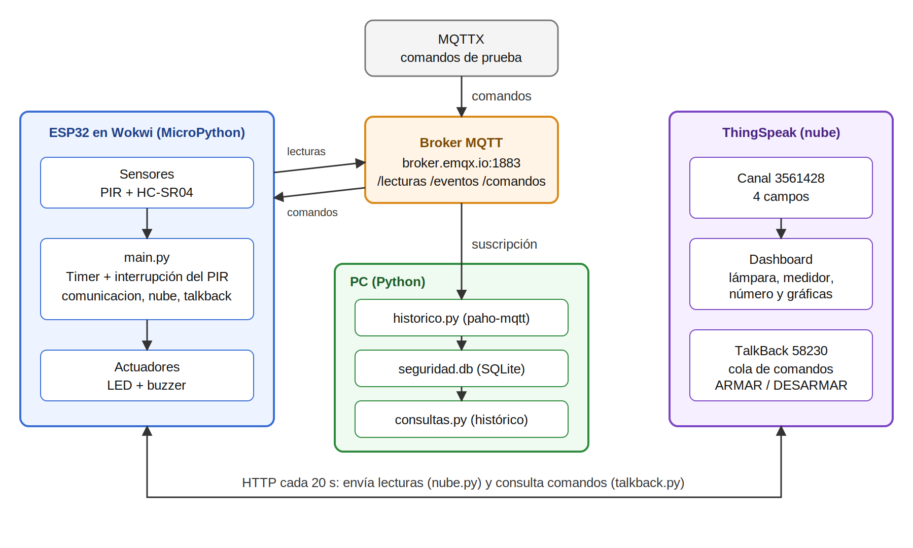

## Hardware simulado

| Componente | Pin del ESP32 |
|---|---|
| Sensor de movimiento PIR | 14 |
| HC-SR04, TRIG | 5 |
| HC-SR04, ECHO | 18 |
| LED (con resistencia) | 27 |
| Buzzer | 26 |

## Estructura del repositorio

```
.
├── README.md
├── requirements.txt
├── arquitectura.svg / arquitectura.png
├── capturas/
├── wokwi/                   código del ESP32 (exportado de Wokwi)
│   ├── main.py
│   ├── config.py
│   ├── sensores.py
│   ├── actuadores.py
│   ├── comunicacion.py
│   ├── tiempo.py
│   ├── auditoria.py
│   ├── nube.py
│   ├── talkback.py
│   ├── diagram.json
│   └── secretos_ejemplo.py
└── base-de-datos/
    ├── historico.py         escucha MQTT y guarda en SQLite
    ├── consultas.py         consultas del histórico
    ├── consultas.sql        las mismas consultas en SQL
    └── schema.sql           tablas de la base de datos
```

Cada módulo del ESP32 tiene una sola tarea: `sensores.py` lee, `actuadores.py` enciende la alarma, `comunicacion.py` maneja el Wi-Fi y MQTT, `tiempo.py` sincroniza la hora por NTP, `auditoria.py` registra los accesos denegados, `nube.py` envía a ThingSpeak y `talkback.py` consulta los comandos de la nube. `main.py` los coordina.

## Mensajes MQTT

Broker: `broker.emqx.io`, puerto 1883. Base de los topics: `utp/fisc/ds8/seguridad_g8`.

| Topic | Dirección | Campos |
|---|---|---|
| `/lecturas` | dispositivo a nube | device_id, timestamp, hora_sincronizada, movimiento, distancia, alarma, armado |
| `/eventos` | dispositivo a nube | device_id, timestamp, hora_sincronizada, tipo, detalle |
| `/comandos` | nube a dispositivo | cmd (`ARMAR` o `DESARMAR`), auth_token |

Tipos de evento: SISTEMA_INICIADO, ALARMA_ACTIVADA, ALARMA_DESACTIVADA, COMANDO_EJECUTADO, COMANDO_RECHAZADO y MQTT_RECONECTADO.

El timestamp es Unix en UTC. El ESP32 cuenta los segundos desde el año 2000, así que el código le suma 946684800 para llevarlo a 1970. La conversión a hora de Panamá (UTC-5) se hace solo al mostrar los datos. Si el NTP falla, el programa sigue funcionando, marca `hora_sincronizada: false` y reintenta cada 60 segundos hasta lograrlo.

## Base de datos

SQLite, con dos tablas definidas en `base-de-datos/schema.sql`:

- `lecturas`: una fila por lectura de sensores
- `eventos`: alarmas y comandos ejecutados o rechazados, con su tipo y detalle

`base-de-datos/consultas.py` tiene las consultas para recuperar el histórico: lecturas por rango de tiempo, eventos por tipo, conteo de alarmas y un resumen de eventos por tipo.

## Nube: ThingSpeak

Canal "Sistema de Seguridad G8" (ID 3561428), privado, con cuatro campos:

| Campo | Contenido |
|---|---|
| 1 | movimiento |
| 2 | distancia (cm) |
| 3 | alarma (0 o 1) |
| 4 | armado (0 o 1) |

Dashboard: una lámpara roja que se enciende cuando el campo 3 vale 1, un medidor de distancia de 0 a 400 cm, un indicador numérico del estado armado y una gráfica por campo.

Comandos desde la nube: TalkBack "Comandos seguridad G8" (ID 58230). Se escribe `ARMAR` o `DESARMAR` en la tabla de comandos y el ESP32 lo ejecuta en la siguiente consulta. Cada comando se consume una sola vez.

La cuenta gratuita de ThingSpeak exige al menos 15 segundos entre envíos, por eso el dispositivo manda una lectura cada 20 segundos. Un movimiento muy corto puede no verse en el dashboard, aunque sí queda en la base de datos local.

## Cómo ejecutarlo

Dispositivo (Wokwi):

1. Crear un proyecto ESP32 con MicroPython y cargar los archivos de `wokwi/` junto con `diagram.json`.
2. Copiar `secretos_ejemplo.py` como `secretos.py` y poner la Write API Key del canal, la API Key del TalkBack y el token de comandos MQTT.
3. Iniciar la simulación.

PC:

1. `pip install -r requirements.txt` (en Windows puede ser `py -m pip install -r requirements.txt`).
2. Dentro de la carpeta `base-de-datos`, correr `python historico.py` y dejarlo abierto mientras corre la simulación.
3. Con la simulación andando un rato, correr `python consultas.py` para ver el histórico.

Para probar comandos por MQTT, publicar en `utp/fisc/ds8/seguridad_g8/comandos` un mensaje como este (el token real está en `secretos.py`, que no se sube al repositorio):

```json
{"cmd": "DESARMAR", "auth_token": "TU_TOKEN"}
```

## Seguridad

- Los comandos por MQTT se rechazan si el `auth_token` falta o no coincide, y el intento queda en el log de auditoría y como evento COMANDO_RECHAZADO.
- Los mensajes que no son JSON válido también se rechazan.
- Las claves de ThingSpeak y el token de comandos están en `secretos.py`, que no se sube al repositorio.

## Pruebas realizadas

- El ESP32 conecta al Wi-Fi, sincroniza la hora y se conecta al broker.
- Con Simulate motion en el PIR se activa la alarma y se publican ALARMA_ACTIVADA y, después, ALARMA_DESACTIVADA.
- Con un objeto a menos de 50 cm y sin movimiento, la alarma también se activa (por distancia).
- DESARMAR y ARMAR con el token correcto cambian el estado.
- Un token falso, un comando desconocido o un mensaje que no es JSON válido se rechaza y se registra.
- Si el NTP falla al arrancar, el sistema sigue funcionando y marca la hora como no sincronizada.
- La base de datos guardó 44 lecturas y 8 eventos en la prueba inicial, y `consultas.py` los recupera.
- ThingSpeak recibe las lecturas y el dashboard se actualiza.
- Los comandos ARMAR y DESARMAR puestos en el TalkBack se ejecutan y salen de la cola.

## Problemas encontrados

El más largo de resolver fue un error `-1` que se repetía en la consola. La causa era que `umqtt.simple` calcula el largo del mensaje contando caracteres, y la `í` de "dispositivo en línea" ocupa dos bytes, así que el paquete salía un byte corto y el broker cerraba la conexión. Se resolvió enviando el mensaje ya codificado: `publish(topic, mensaje.encode("utf-8"))`. También se agregó reconexión automática a MQTT cada 5 segundos.

## Capturas

| Captura | Qué muestra |
|---|---|
| 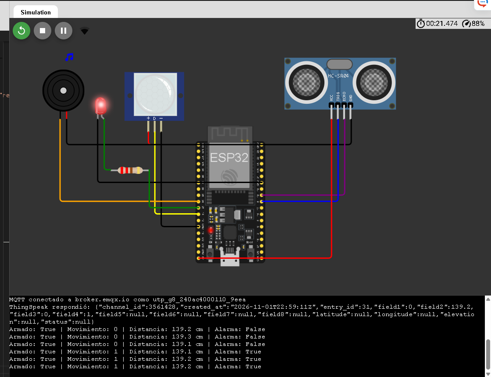 | Circuito completo en Wokwi, con la simulación corriendo y la alarma activa |
| 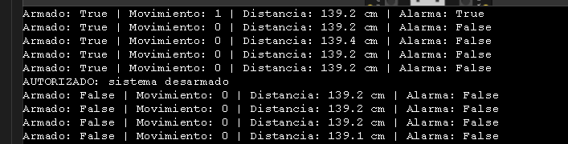 | Consola de Wokwi: alarma, comandos y auditoría |
| 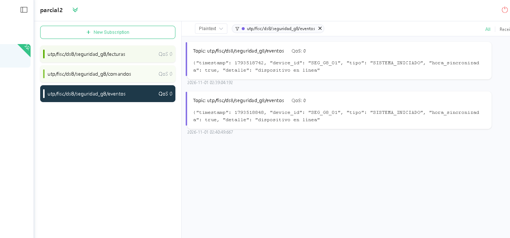 | MQTTX recibiendo eventos |
| 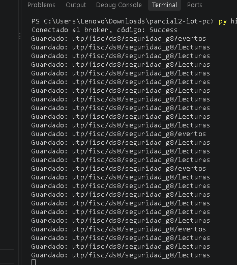 | `historico.py` guardando mensajes |
| 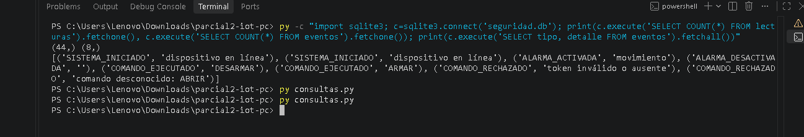 | Conteo y eventos guardados en SQLite |
| 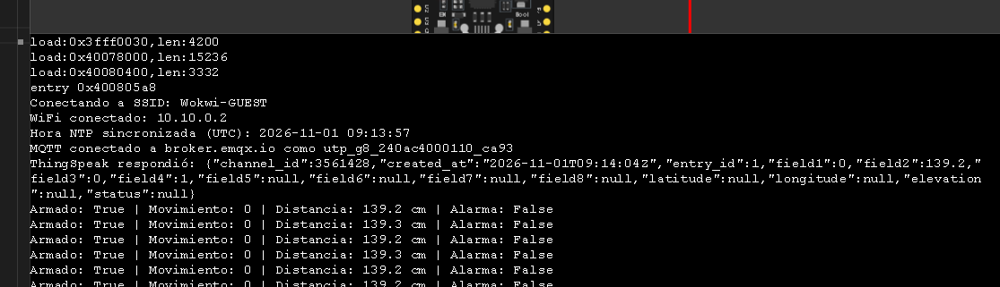 | Respuesta de ThingSpeak en la consola |
| 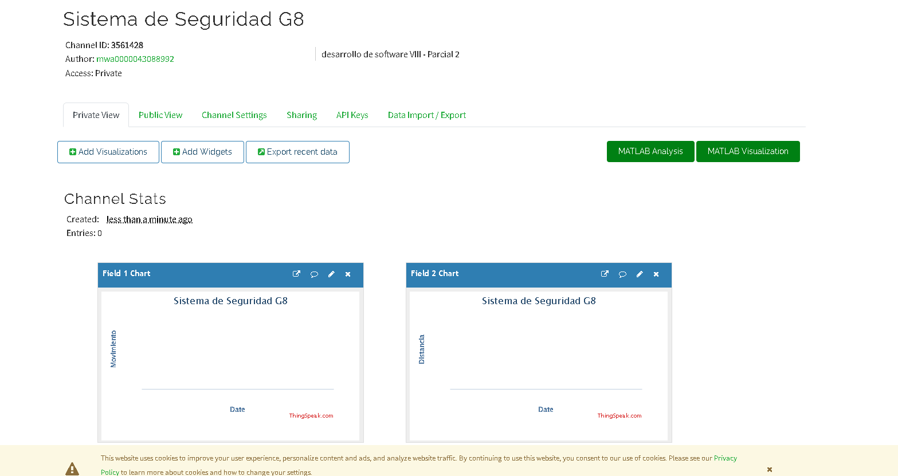 | Canal de ThingSpeak |
| 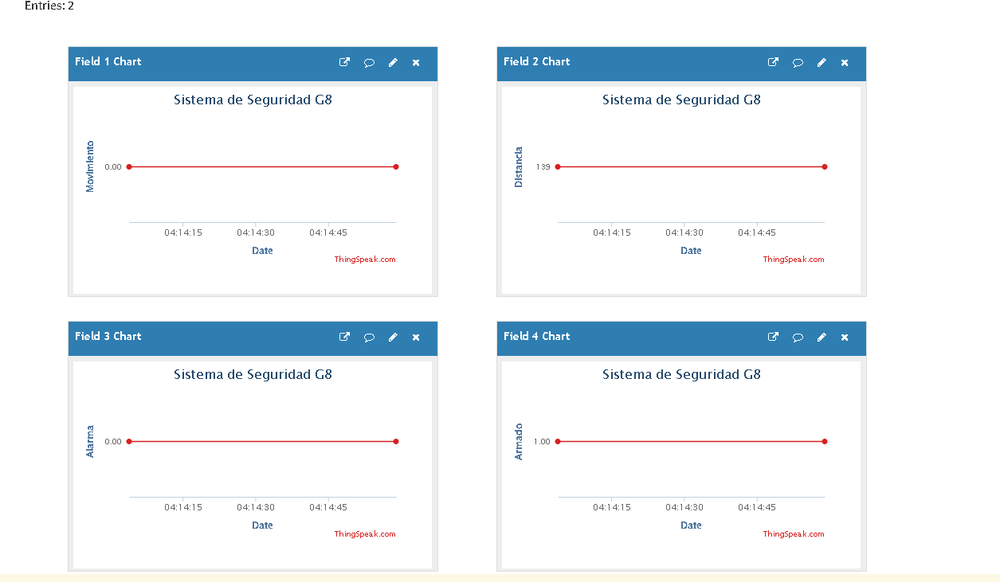 | Gráficas en ThingSpeak |
| 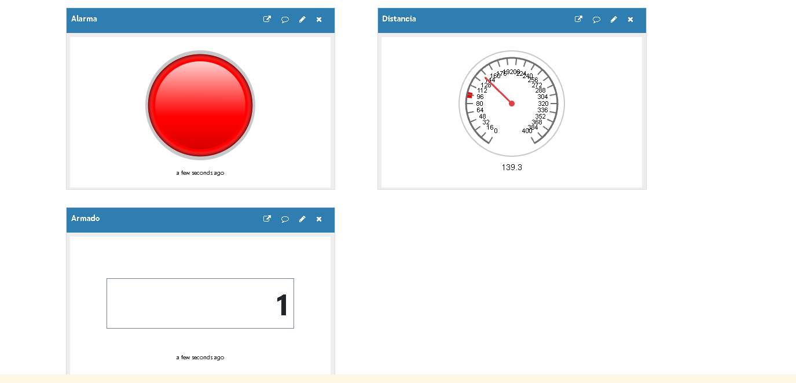 | Dashboard con la alarma encendida |
| 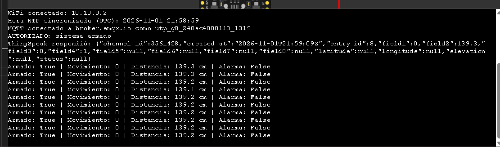 | Comando de TalkBack ejecutado en la consola |
| 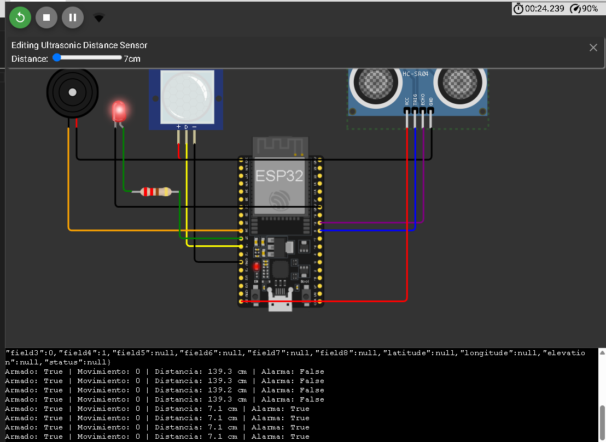 | Alarma activada solo por distancia (objeto a 7 cm, sin movimiento) |
| 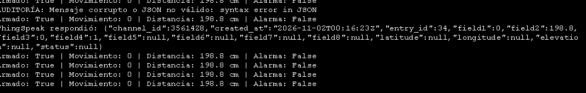 | Consola: mensaje que no es JSON válido, rechazado y auditado |
| 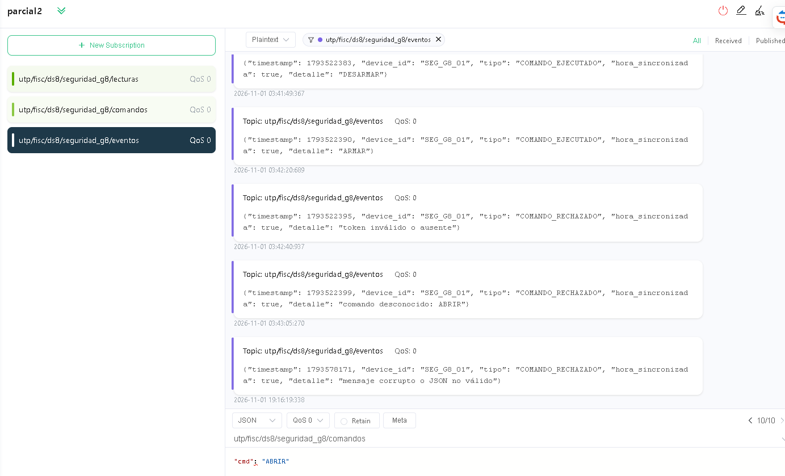 | MQTTX: comandos ejecutados y tres tipos de rechazo (token, comando desconocido, JSON corrupto) |
| 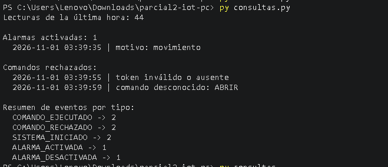 | Salida de `consultas.py`: alarmas, comandos rechazados y resumen por tipo |
| 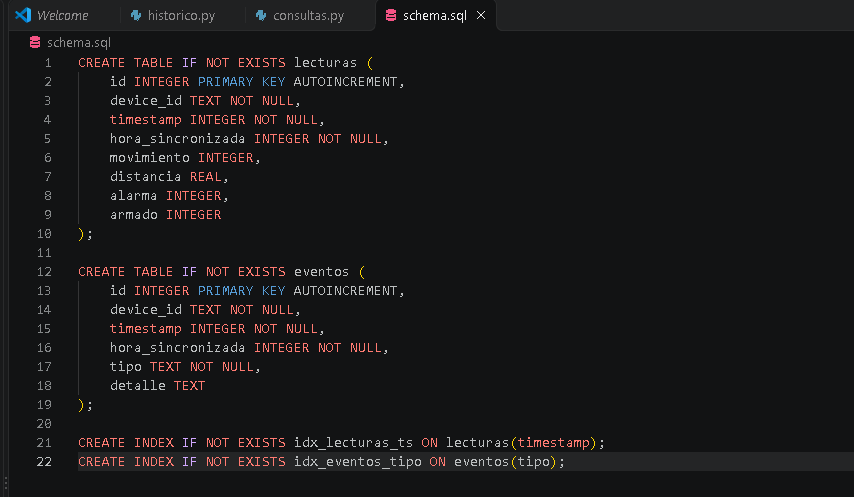 | Tablas e índices de la base de datos (`schema.sql`) |
| 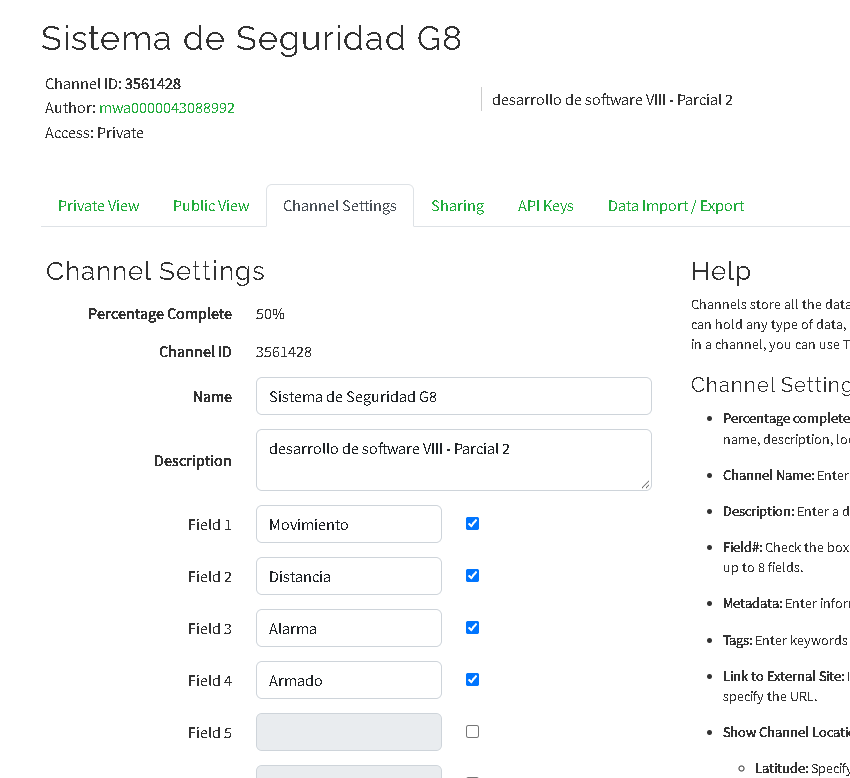 | Configuración del canal de ThingSpeak: nombre y cuatro campos |
| 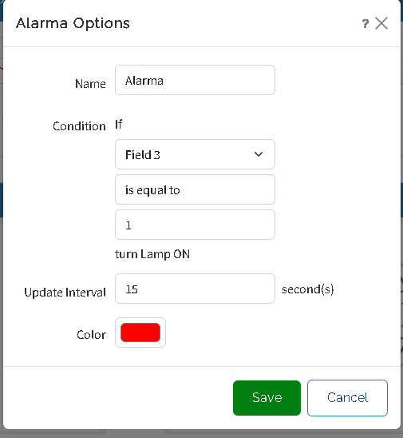 | Widget de la lámpara de alarma: se enciende si el campo 3 es igual a 1 |
| 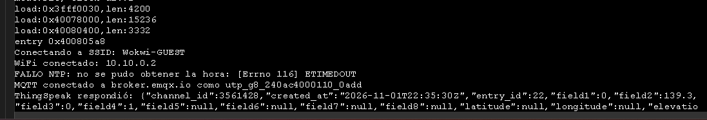 | Falla del NTP (ETIMEDOUT): el sistema sigue funcionando sin hora |

## Integrantes y parte que explica

| Integrante | Parte del sistema que explica |
|---|---|
| Yomayri Martínez | Dispositivo: sensores, actuadores, Timer, interrupción del PIR y regla de alarma |
| Marleni Barría | Comunicación y seguridad: MQTT, topics, token, auditoría y reconexión |
| Carolina Rodríguez | Datos: hora (NTP y UTC), base de datos SQLite e histórico |
| Ameth Díaz | Nube: ThingSpeak, dashboard y comandos por TalkBack |
